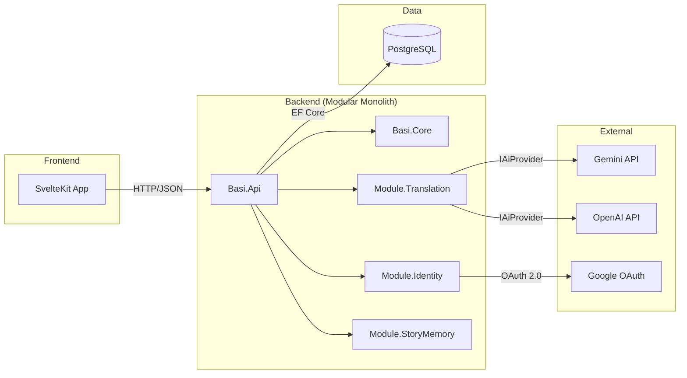
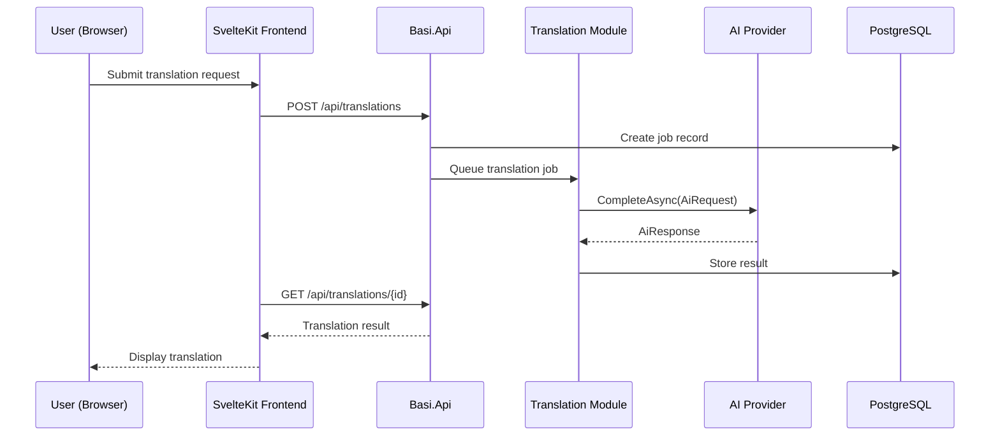

# BASI — Architecture

## System Overview

## Module Structure

| Module | Responsibility |
| ------ | -------------- |
| **Basi.Api** | HTTP entry point, middleware, DI composition, health checks |
| **Basi.Core** | Shared interfaces (`IAiProvider`), domain models, contracts |
| **Basi.Module.Identity** | Google OAuth, session management, user authorization |
| **Basi.Module.Translation** | AI provider adapters, translation engine, job processing |
| **Basi.Module.StoryMemory** | Character/term extraction, glossary, context management |

## Data Flow

## Key Patterns

### Provider Adapter Pattern

All AI providers implement `IAiProvider`. This allows:
- **MockAiProvider** for testing (simulates success, errors, timeouts, rate limits)
- **GeminiProvider** / **OpenAiProvider** for production
- Easy addition of new providers without changing core logic

### Modular Monolith

Each module is a separate .NET project with its own concerns, registered via DI in `Basi.Api`. Modules communicate through shared interfaces in `Basi.Core`. This gives module isolation without the operational overhead of microservices.

### Background Job Queue

Translation jobs are processed asynchronously using a PostgreSQL-backed queue:
- Jobs persist across restarts
- State machine: Created → Queued → Processing → Completed/Failed
- Supports cancellation and retry

## Database

- **Engine**: PostgreSQL 16+
- **ORM**: Entity Framework Core (code-first migrations)
- **Connection**: Configured via `appsettings.json`, never hardcoded
- **Schemas**: Each module may define its own tables

## Security Principles

1. **BYOK**: Users provide their own API keys; keys are held in RAM only, never written to disk or database
2. **Authentication**: Google OAuth 2.0 with cookie-based sessions
3. **Authorization**: All data is owned by a user; every endpoint enforces ownership checks
4. **CSRF**: Antiforgery tokens on state-changing operations
5. **CORS**: Restricted to the frontend origin
