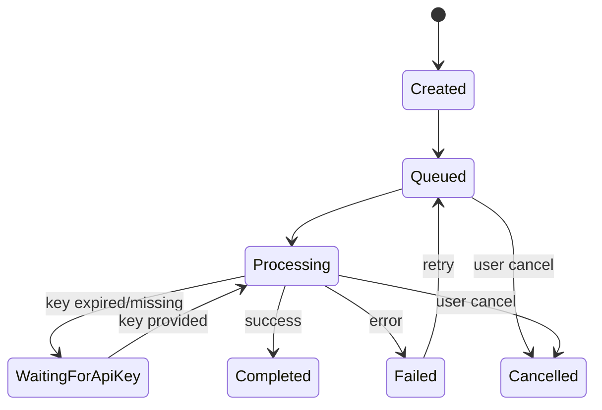

# BASI — Contracts

## IAiProvider Interface

```csharp
public interface IAiProvider
{
    Task<AiResponse> CompleteAsync(AiRequest request, CancellationToken ct);
}
```

## AiRequest

```csharp
public record AiRequest(
    string Model,
    string SystemPrompt,
    string UserPrompt,
    int MaxTokens = 2048,
    double Temperature = 0.7
);
```

## AiResponse

```csharp
public record AiResponse(
    string Content,
    int PromptTokens,
    int CompletionTokens,
    int TotalTokens,
    string ModelUsed,
    FinishReason FinishReason
);
```

## FinishReason Enum

```csharp
public enum FinishReason
{
    Stop,
    MaxTokens,
    ContentFiltered,
    Error
}
```

## AiProviderError

```csharp
public class AiProviderError : Exception
{
    public AiErrorCode ErrorCode { get; }
}

public enum AiErrorCode
{
    RateLimited,
    InvalidApiKey,
    ModelNotFound,
    ContentFiltered,
    NetworkError,
    Unknown
}
```

## Health Check Response

```json
{
  "status": "healthy",
  "timestamp": "2024-01-01T00:00:00Z",
  "version": "0.1.0",
  "database": "connected"
}
```

`database` is `"connected"` or `"disconnected"`.

## Job State Machine

States for translation jobs (future implementation):



| State | Description |
| ----- | ----------- |
| Created | Job record created, not yet queued |
| Queued | Waiting for a worker to pick it up |
| Processing | Actively calling AI provider |
| WaitingForApiKey | Paused — API key missing or invalid |
| Completed | Translation finished successfully |
| Failed | Terminated due to error |
| Cancelled | Cancelled by user |

## Translation Segment (Future)

Each translation job is split into segments for granular tracking:

```csharp
public record TranslationSegment(
    Guid Id,
    int Index,
    string SourceText,
    string? TranslatedText,
    SegmentStatus Status  // Pending, Translating, Completed, Failed
);
```
